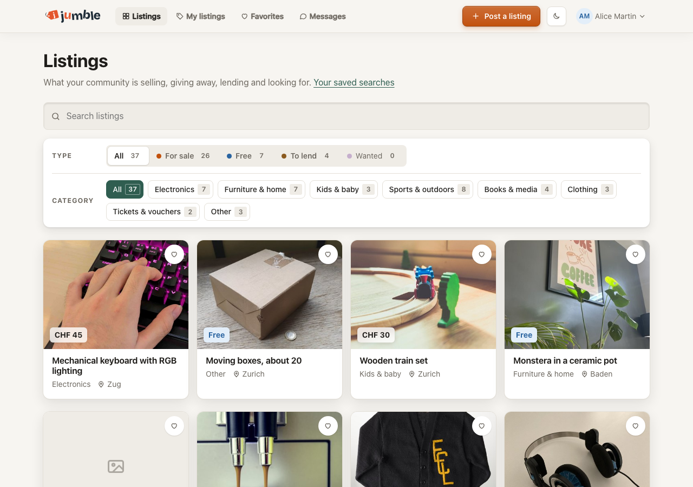
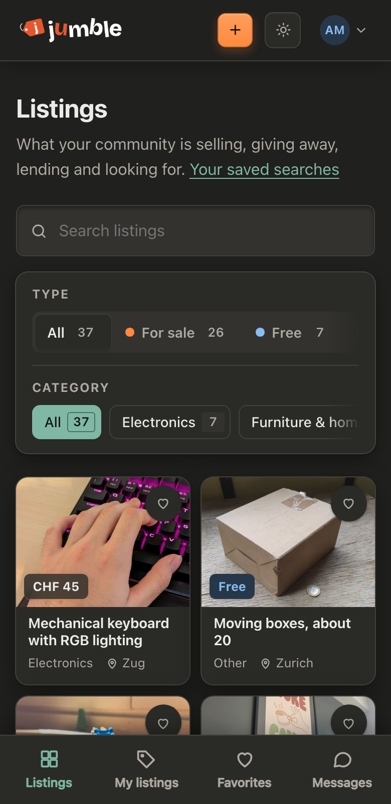
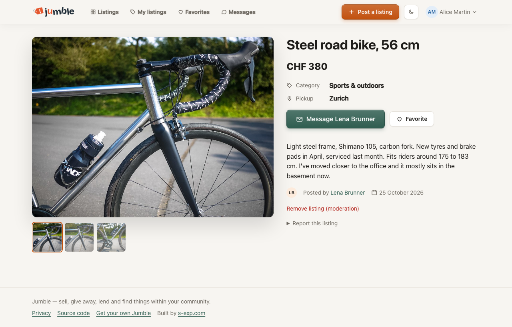

<h1>
  <picture>
    <source media="(prefers-color-scheme: dark)" srcset="assets/jumble-web-pngs-hq/jumble-logo-white-640.png">
    
  </picture>
</h1>

A marketplace for a community: the people of a company, a school, a
co-working space or a neighbourhood sell, give away and lend things to each
other, and talk about them, in one place that belongs to them.

Jumble is small on purpose. There are no payments, ratings or ads: members
know each other, or at least share something, and sort the rest out face
to face. One deployment serves one community, on one server, with its data
in a single SQLite file backed up continuously to object storage.

A demo runs at [demo.jumbl.ing](https://demo.jumbl.ing).

Jumble is young and changing quickly.

<p>
  
  
</p>
<p>
  
</p>

## What it does

- **Post** something to sell, give away or lend, or what you are looking
  for: a title, a description
  (with simple formatting), up to five photos, a category, a price when it is
  for sale, and where to pick it up.
- **Browse** the board by type and category, or **search** it. New listings
  show first; filters and search work together and can be shared as links.
- **Save searches** and get a daily email with what is new for them.
- **Favorite** listings to find them again, from a heart on the listing or
  its card. Favorites are private: nobody else, the owner included, sees
  them.
- **Message** the person behind a listing. Conversations are private
  between two people and stay attached to the listing they are about.
  Unread messages show in the header, can notify members' phones and
  computers at once, and are emailed after a few minutes if still unread
  (members can turn either off).
- **Manage** your listings: edit them, mark them sold or given away, put
  them back, remove them.
- **Own your data**: download everything Jumble holds about you, or delete
  your account; what you wrote to others stays, from "A former member".
- **Report** a listing that does not belong. The community's moderators are
  emailed, review reports on one page, and remove the listing (its owner is
  told why) or dismiss the reports. Moderators can also remove any listing
  straight from its page.
- **Sign in** with a link sent by email, or with the accounts your community
  already has (Google Workspace, Keycloak and other OpenID Connect
  providers). Open to anyone, to some email domains, or to a list of
  addresses.

Each community gives it its own name, logo and colours (fifteen palettes,
light and dark, chosen by its moderators); Jumble stays in the footer.

It works without JavaScript, with JavaScript making the board and forms
smoother. It has light and dark themes, labelled forms and plain HTML
links and buttons throughout.

## What it needs

- A server or VM with Podman and systemd. Jumble is built for a small one (1 CPU,
  2 GB of memory): one process, one SQLite file.
- A domain name pointing at it (Jumble gets its certificate from Let's
  Encrypt and serves HTTPS itself), or a reverse proxy of your own.
- S3-compatible object storage: one bucket for photos, one for backups.
- An SMTP server or account to send email, which is also all email sign-in
  needs; or an OpenID Connect provider for sign-in (for example Google
  Workspace, Keycloak, Okta).

## How it works

One JVM process serves the pages, over HTTPS with a certificate from Let's
Encrypt, or behind a reverse proxy of your own. Its data is a SQLite file,
which Litestream copies to object storage as it changes; photos are in
S3-compatible storage; email goes out by SMTP; members sign in by links
sent by email or through an OpenID Connect provider.
[Deployment](doc/deployment.md) has a diagram.

## Documentation

- [User guide](doc/user-guide.md): for members and moderators.
- [Quickstart](doc/quickstart.md): what services to use, and a Jumble
  running in about half an hour.
- [Deployment](doc/deployment.md): getting a Jumble running, on a cloud
  provider in minutes (the scripts provided do everything) or on any
  server; with
  [cloud providers](doc/cloud-providers.md) and
  [step by step](doc/deployment-reference.md) for the details.
- [Running it](doc/operations.md): upgrading, logs, monitoring, backups and
  restoring, and a security checklist.
- [Configuration](doc/configuration.md): every setting, with examples for
  common providers.
- [Development](doc/development.md): working on Jumble itself.

## Try it locally

With Docker and Docker Compose v2 (`docker compose`), JDK 25 or later, the
[Clojure CLI](https://clojure.org/guides/install_clojure) and
[libvips](https://www.libvips.org/install.html)'s `vips` command
(`brew install vips`, `apt install libvips-tools`). The development
services take ports 1025, 3900, 5556, 8025, 14000 and 15000 on localhost,
and the app 8080: they must be free.

```sh
docker compose up -d                # sign-in, storage, email and certificate stand-ins
dev/s3-init.sh                      # once: create the storage buckets
clojure -M:dev:run                  # http://localhost:8080
```

Sign in as `alice@example.com` with password `password`, then
`clojure -M:dev:seed` fills the board with sample members and listings.
Emails the app sends show at http://localhost:8025.

Before sending a change, `dev/check.sh` runs the tests, the linter and the
checks of the deploy scripts, as CI does; see
[development](doc/development.md).

## Built with

Clojure on the JVM (virtual threads), SQLite with full-text search,
server-rendered HTML with [Datastar](https://data-star.dev) for
interactivity, and [Litestream](https://litestream.io) for continuous
backups.

## License

[GNU Affero General Public License 3.0](LICENSE), with a permission to
combine it with Clojure and other Eclipse Public License libraries (see
[NOTICE](NOTICE)). Use, modify and run Jumble freely, including for your
organisation. If you run a modified Jumble for others, as a hosted service
too, offer them its source code under the same license.

## For organisations

Jumble stays free to run, for any community. For organisations that want
more than the code:

- **Hosting**: a Jumble run for you, on your own address.
- **Support and setup**: help installing and running it, with agreed
  response times.
- **A commercial license**, for uses the AGPL does not suit: offering a
  modified Jumble to others without sharing the changes, say.

Write to [info@jumbl.ing](mailto:info@jumbl.ing).

## Contributing

Contributions are welcome; see [CONTRIBUTING.md](CONTRIBUTING.md). They
are accepted under the [contributor license agreement](CLA.md), which lets
Jumble be offered under a commercial license as well as the AGPL.
